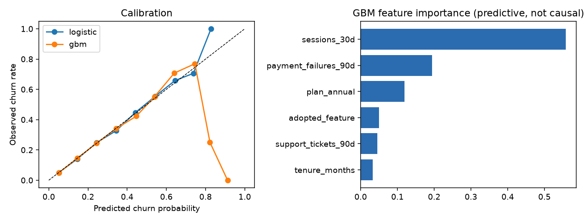
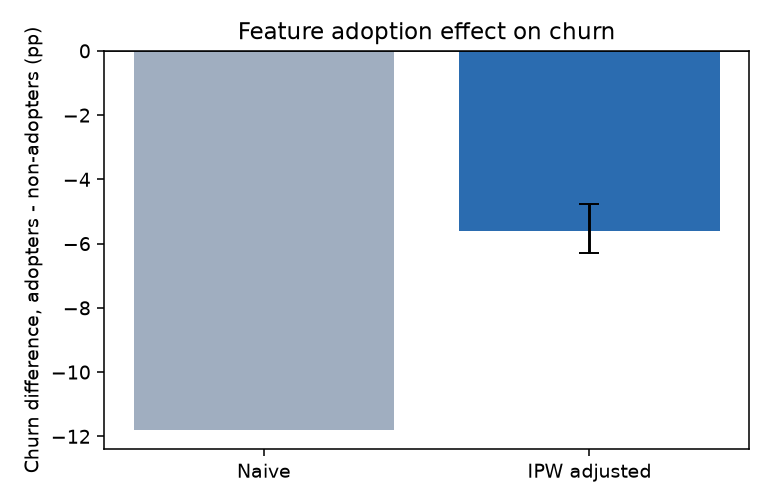

# Churn model and feature-impact analysis

**Synthetic data, real method.** All users are simulated in `analysis.py` (fixed seed). No employer data.

## Questions
- A. Can we rank users by churn risk well enough to target retention outreach?
- B. Does adopting a product feature actually *reduce* churn, or do engaged users just adopt it more?

## A. Predictive model
| model | ROC AUC | average precision |
|---|---|---|
| logistic regression | 0.754 | 0.386 |
| gradient boosting | 0.751 | 0.376 |

The top 10% of users by predicted risk churn at **2.7x** the base rate (16.7%), so a
retention campaign aimed at them is far more efficient than a blanket one. Calibration is checked so
that predicted probabilities can be used for cost-benefit decisions, not just ranking.
Feature importance is *predictive*, not causal.

## B. Causal question: feature adoption and churn
Engaged users both adopt the feature more and churn less, so a naive comparison is confounded.
- Naive difference in churn (adopters - non-adopters): **-11.8pp**
- Inverse-probability-weighted estimate (propensity score on user covariates): **-5.6pp**
  (95% bootstrap CI -6.3 to -4.8pp)
- The simulation's TRUE average effect (computed from counterfactual probabilities) is **-5.3pp**.
  The naive estimate is off by 6.5pp; the adjusted estimate is off by 0.3pp.

## Caveats I would state on a real project
- Propensity adjustment only handles *observed* confounders; a randomized rollout (A/B test, see
  `../ab-test-experimentation`) is the stronger design.
- Check overlap (propensity scores near 0 or 1) and covariate balance before trusting weights.
- Do not use predictive feature importance as evidence that changing a feature will change churn.

## Run it
`pip install pandas numpy scikit-learn matplotlib` then `python analysis.py`.
